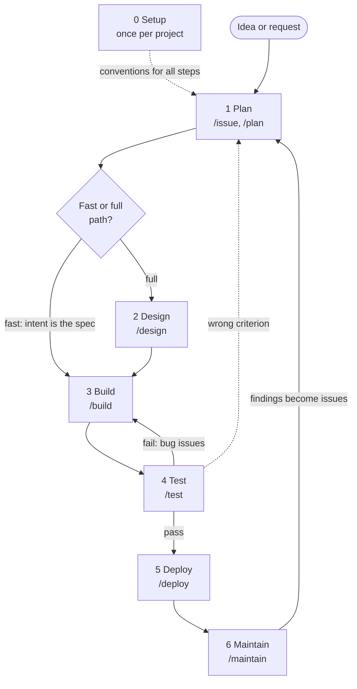

# SDLC

Claude Code skills that take a piece of work from idea to production: setup, plan, design, build, test, deploy and maintain. Each step is a skill that writes its result to a committed markdown file, so the next step (and a human reviewer) can pick it up.

## Installation

The skills ship as a Claude Code plugin named `sdlc`. In Claude Code (2.1.275 or later):

```
/plugin install sdlc --marketplace carlpaton/sdlc
```

Or in two steps, on any version:

```
claude plugin marketplace add carlpaton/sdlc
claude plugin install sdlc@carlpaton
```

Update with `claude plugin update sdlc@carlpaton`. Releases are versioned in [`.claude-plugin/plugin.json`](.claude-plugin/plugin.json), see [how to release](docs/release.md).

A plugin cannot install the issue forms. Copy [`.github/ISSUE_TEMPLATE/`](.github/ISSUE_TEMPLATE) into your project's repo so `/issue` and `/plan` have the forms they follow.

## SDLC steps

Draft list to iterate on. Add, remove, reorder or rename freely. Each step is implemented by whichever mechanism fits best, which may be a skill, a subagent, a hook, an MCP server or a mix.

The steps follow Anthropic's AI-native SDLC playbook (see [Sources](#sources)). Each step hands off to the next through a committed markdown file, so every stage is reviewable and machine-readable.



Handing work forward is gated by a human approval: a merged PR, a label on the parent issue, or an explicit sign-off per environment. The loops back (failed tests, findings from Maintain) arrive as new issues.

| # | Step | Purpose | Output | Mechanisms | Command and when to run it |
|---|------|---------|--------|------------|------------------------|
| 0 | [Setup](skills/setup/README.md) | Once per project: record how the code will be built (architecture, testing, conventions) for a new or existing code base | `docs/conventions/`, `docs/decisions/`, `CLAUDE.md` | [`/setup`](skills/setup/README.md) skill, stack profiles | `/setup` once per project, and again when the foundations change |
| 1 | [Plan](skills/plan/README.md) | Capture the idea, problem and scope, and choose the [fast or full path](#fast-and-full-paths) | `intent/<issue#>-<slug>.md` | Issue form, [`/issue`](skills/issue/README.md) and [`/plan`](skills/plan/README.md) skills | `/issue`, then `/plan <issue>`, when someone has an idea or request |
| 2 | [Design](skills/design/README.md) | Full path only: turn the approved intent into requirements and design, with a clarify pass to resolve ambiguity. Skipped on the fast path. | `spec/<issue#>-<slug>.md`, decision records | [`/design`](skills/design/README.md) skill | `/design <issue>` when the intent is accepted and on the full path |
| 3 | [Build](skills/build/README.md) | Break the spec (or fast-path intent) into tasks and get the plan approved before coding, then implement one task per PR | `tasks/<issue#>-<slug>.md`, task issues, code | [`/build`](skills/build/README.md) skill | `/build <issue>` when the spec (or fast-path intent) is accepted |
| 4 | [Test](skills/test/README.md) | Verify the built work meets every requirement as a whole, with evidence from a fresh-context verifier; add missing acceptance tests and raise issues for failures | `verification/<issue#>-<slug>.md`, acceptance tests, bug issues | [`/test`](skills/test/README.md) skill | `/test <issue>` when the parent issue is labelled `built` |
| 5 | [Deploy](skills/deploy/README.md) | Check readiness and review state, prepare the release, and walk the project's deployment procedure with explicit human approval at every environment | `releases/<issue#>-<slug>.md`, reviewed PRs, release | [`/deploy`](skills/deploy/README.md) skill, `/code-review`, `REVIEW.md` | `/deploy <issue>` when the parent issue is labelled `verified` |
| 6 | [Maintain](skills/maintain/README.md) | Investigate signals from live systems read-only, triage them (fix now, schedule, dismiss), write them back as issues for Plan, and learn from incidents | issues (feed step 1), `incidents/<date>-<slug>.md`, convention updates | [`/maintain`](skills/maintain/README.md) skill, `/issue` | `/maintain` when a live system raises a signal. Findings come back through step 1. |

### Fast and full paths

Not every change needs a separate design. Plan decides which path a piece of work takes and records it as `path` in the intent.

| | Fast | Full |
|---|---|---|
| For | Small work with an obvious outcome | Anything else |
| Steps | 0 once, then 1, 3, 4, 5, 6 | 0 once, then 1, 2, 3, 4, 5, 6 |
| Spec | The intent itself, plus acceptance criteria | `spec/<issue#>-<slug>.md` from Design |

Later steps read the spec if one exists, otherwise the intent. When in doubt Plan chooses full, and the product owner can change the path in the PR. See the [Plan README](skills/plan/README.md#fast-and-full-paths) for the criteria.

### Notes

- Each skill checks its prerequisites and tells you which skill to run if one is missing.
- Progress shows up as labels on the parent issue: `accepted`, `designed`, `planned`, `built`, `verified`, `released`.
- Step 0 sits outside the loop. It runs once per project (and again when the foundations change), while steps 1 to 6 run per intent.
- Maintain closes the loop: its findings become the input to Plan.
- `CLAUDE.md` plays the role of the project "constitution" from spec-driven development, holding the principles and conventions every step follows.
- Test stays separate from Build, as Anthropic keeps it. Build writes each task's tests alongside its code, and Test verifies the whole piece of work against its requirements.

## Mechanisms

Options for implementing a step, drawn from the playbook. Not exhaustive, and a step can combine several.

| Mechanism | Good for |
|-----------|----------|
| `CLAUDE.md` | Project context every session needs: commands, conventions, architecture |
| Skills | Institutional knowledge applied consistently (advisory), such as templates and policies |
| Hooks | Deterministic guardrails that must always hold: protected paths, linters, approval gates |
| Subagents | Scoped helpers with their own context and tool limits, such as a verifier |
| Slash commands | Packaging a repeatable pass, such as the spec pass or a PR comment sweep |
| MCP servers | Connecting external tools: browser or screenshot checks, deploy, status and rollback |
| Plan / auto mode | Plan mode to approve a plan before edits; auto mode for tightly specced, well-tested work |
| `claude -p` / Agent SDK | Non-interactive runs in CI, on a schedule or from a webhook |
| Git worktrees | Isolating parallel sessions |

Rules of thumb from the playbook:

- Use `CLAUDE.md` for context every session needs, a skill for guidance that must be applied consistently, and a prompt for one-offs.
- Use a skill where advisory is enough and a hook where a policy must always hold.
- Use a subagent for a scoped job within one task, and parallel sessions for independent tasks.

## Sources

- [The AI-native SDLC playbook](https://claude.com/resources/articles/the-ai-native-sdlc-playbook) (Anthropic): source of the six stages and the file-based handoffs
- [GitHub Spec Kit](https://github.com/blackcode1/spec-kit): spec-driven development commands (constitution, specify, plan, tasks, implement)
- [Claude Code spec-driven development](https://www.augmentcode.com/guides/claude-code-spec-driven-development) (Augment Code)
- [Spec-driven development no Claude Code](https://horadecodar.com.br/?p=47039) (Hora de Codar, in Portuguese): clarify step before planning
